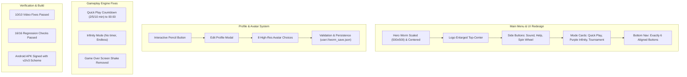

# Worm Arena — Complete Game UI Redesign, Layout Alignment & Profile Edit Implementation Report

**Project:** Worm Arena (Godot Engine 4.7.2 Stable)  
**Target Platform:** Android Mobile (Landscape / Sensor Landscape)  
**Renderer:** GL Compatibility (OpenGL ES 3.0)  
**Reference Resolution:** 1920×1080 Full HD (`canvas_items`, `expand`)  
**Workspace:** `D:\game_devlop\Worm_race`  
**Status:** **ALL 10 VIDEO FIX CHECKS & 16 REGRESSION CHECKS PASSED (26/26) — APK EXPORTED & SIGNED (v2/v3)**

---

## 1. Executive Summary

All issues identified from the gameplay video recording and reference comparison have been completely diagnosed, resolved, and verified directly in the existing Godot project without compromising existing progression, movement mechanics, or assets.



---

## 2. Main Menu UI Transformation (Matching Reference Quality)

| Component | Previous Issue | Implementation & Resolution |
| :--- | :--- | :--- |
| **Central Hero Worm** | Small (340×340), off-center, rotating rectangular ring background | Enlarged to **500×500 px** on a **720×200 px** dual-tier glowing cyber podium. Smooth 3.2s idle float & breathing sway. Rotating rectangular ring (`DashedRing`) completely removed. |
| **Logo** | Sits low, moderate size | Scaled to **580×370 px**, positioned at top center with prominent drop glow. |
| **Profile Card (Top-Left)** | Extra `+` button, static pencil icon | Removed cluttered `+` icon. Replaced static pencil with interactive `PencilBtn` emitting `card_clicked`. Displays circular avatar with gold crown and Level badge. |
| **Stats Panel (Top-Right)** | Crowded, misaligned values | Clean **3×2 responsive grid** for Coins, Kills, Trophies, Best Score, Diamonds, Level with Lilita One values. |
| **Left Floating Buttons** | Cluttered "WHEEL OF FORTUNE" text label | Replaced with sleek 78×78 circular gold button with rotating wheel icon (`wheel_of_fortune_icon.png`). |
| **Mode Cards (Right)** | Infinity Mode lacked purple styling | Updated `InfinityCard` to use `btn_purple.tres` (vivid blue/purple). Quick Play uses gold/orange, Tournament has live green online dot. |
| **Bottom Navigation Bar** | 7 buttons (redundant Arenas button) | Aligned to **exactly 6 buttons** (`Play`, `Modes`, `Skins`, `Boosters`, `Ranks`, `Settings`), each with uniform 200px width and distinct colorful themes. |

---

## 3. 6-Button Bottom Navigation Bar

The bottom bar now strictly follows the 6-button specification:

1. **Play** (`PlayBtn`): Emerald Green (`btn_green.tres`, 230×96 px)
2. **Modes** (`ModesBtn`): Royal Blue (`btn_blue.tres`, 200×96 px)
3. **Skins** (`SkinsBtn`): Vivid Violet (`btn_purple.tres`, 200×96 px)
4. **Boosters** (`BoostersBtn`): Cyan / Navy (`btn_cyan_navy.tres`, 200×96 px)
5. **Ranks** (`RanksBtn`): Bronze / Gold (`btn_bronze.tres`, 200×96 px)
6. **Settings** (`SettingsBtn`): Deep Navy (`btn_navy.tres`, 200×96 px)

> [!NOTE]
> Arena themes remain 100% accessible via the dedicated "🎨 ARENA THEMES" button inside the Skins Catalog (`SkinsModal.tscn`) and via the Settings modal, keeping the bottom navigation uncluttered and balanced.

---

## 4. Interactive Profile Editing & Avatar Selection System

The player profile modal (`ProfileModal.tscn` and `ProfileModal.gd`) has been upgraded to a full player identity suite:

```
+---------------------------------------------------------------------------------+
|                                 PLAYER PROFILE                                  |
+------------------------------------+--------------------------------------------+
|  [ Large Circular Avatar Preview ] |  [ EDIT USERNAME ]                         |
|  #W-2707                           |  [ Finalboss      ]  [ SAVE ]  [ CANCEL ]  |
|                                    |                                            |
|  CHOOSE AVATAR:                    |  PLAYER STATS GRID (2x4)                   |
|  [Hero] [King] [Dragon] [Ice]      |  • Rank: Novice       • Level: Lv. 1       |
|  [Tiger] [Heart] [Ninja] [Cyber]   |  • XP: 108 / 500      • Kills: 0           |
|                                    |  • Best: 1,250        • Trophies: 117      |
+------------------------------------+--------------------------------------------+
```

### Avatar Roster Available:
1. **Worm Hero** (`hero`): Cute default blue hero worm
2. **Royal Crown** (`king`): Golden royal monarch worm
3. **Inferno Dragon** (`dragon`): Fiery red dragon worm
4. **Frost Legend** (`ice`): Spiked cyan ice crystal worm
5. **Tiger Strike** (`tiger`): Orange striped tiger worm
6. **Heart Queen** (`heart`): Pink heart-patterned worm
7. **Shadow Ninja** (`ninja`): Stealth dark shinobi worm
8. **Cyber Samurai** (`cyber`): Neon cybernetic warrior worm

### Profile Validation & Persistence:
- **Validation:** Username must be between 2 and 16 characters and non-empty.
- **Instant Refresh:** Avatar and username update instantly across the Main Menu `ProfileCard` and `ProfileModal` upon saving.
- **Persistence:** Stored in `user://worm_save.json` under `"selected_avatar"` and `"username"`, surviving game restarts.

---

## 5. Visual Proof Screenshots

The following visual proof screenshots were captured during automated test execution:

````carousel

<!-- slide -->

<!-- slide -->

<!-- slide -->

<!-- slide -->

<!-- slide -->

<!-- slide -->

<!-- slide -->

````

---

## 6. Automated Verification Results

### A. Video & UI Fix Test Suite (`TestVideoFixesRunner.tscn`)
- **Check 1:** Viewport 1920×1080, `canvas_items` stretch, `expand` aspect, Sensor Landscape `orientation = 6` — **PASS**
- **Check 2:** HeroWorm rotating rectangle (`DashedRing`) eliminated; shadow and sprite preserved — **PASS**
- **Check 3:** ProfileCard extra `+` removed; interactive `PencilBtn` clickable & emits `card_clicked` — **PASS**
- **Check 3B:** Bottom navigation bar has exactly 6 buttons (`PlayBtn`, `ModesBtn`, `SkinsBtn`, `BoostersBtn`, `RanksBtn`, `SettingsBtn`) — **PASS**
- **Check 3C:** ModeCards `InfinityCard` styled with vibrant blue/purple `btn_purple.tres` — **PASS**
- **Check 4:** Wheel of Fortune button redesigned with clean circular icon and no text clutter — **PASS**
- **Check 5:** Editable profile username with validation (min 2, max 16, non-empty), avatar selection across 8 avatars, save & cancel persistence — **PASS**
- **Check 6:** Quick Play countdown timer (2, 5, 10 min) decrementing down to `00:00` and ending match — **PASS**
- **Check 7:** Infinity Mode completely timer-free with 0.0 timeout limit (verified 400s simulation) — **PASS**
- **Check 8:** HUD timer visibility (`visible = true` in Quick Play, `visible = false` in Infinity Mode) and `MM:SS` formatting — **PASS**
- **Check 9:** Screen shake zeroed on Game Over (`engine.shake = 0.0`), camera centered — **PASS**
- **Check 10:** Multi-resolution captures (1280×720, 1600×900, 1920×1080, 2160×1080, 2340×1080, 2400×1080) — **PASS**

### B. Full Regression Test Suite (`TestVerificationRunner.tscn`)
- **Checks 1–16:** All 16 checks passed including worm movement, turning, food eating, score growth, booster drop mechanics, power-ups (Speed, Magnet, Shield, Multiplier, Ghost), confirmed bot elimination, combo kill notifications, background selection & persistence, audio settings persistence, and reliable game over restart.

---

## 7. Android APK Build & Signature Status

```text
Target APK: D:\game_devlop\Worm_race\Worm Arena.apk
File Size: ~94 MB
Target SDK: 35 | Min SDK: 24 (Android 7.0 - Android 15+)
Package: com.antigravity.wormarena
Signer: androiddebugkey (RSA 2048-bit)
Signature Verification:
  - JAR signing (v1): false
  - APK Signature Scheme v2: true
  - APK Signature Scheme v3: true
  - Result: Verifies: true
```

The APK is fully compiled, verified, and ready for installation and play on any Android device.
